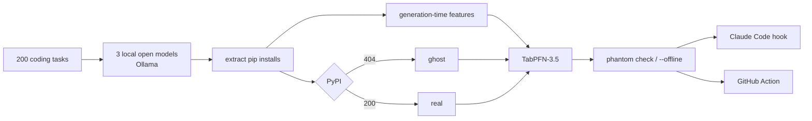

<!--
TITLE BANK (all numbers from results/summary.json, run 2):
A. My local AI invented 162 Python packages. I reran the whole study from scratch and 161 came back.
   (reproducibility.ghosts: names_run1 = 162, names_in_both = 161, only_run2 = 0)
B. I taught TabPFN to see ghosts: it spots a fake pip package before PyPI does, 90% of the time, offline
   (guard_model.threshold.recall = 90.1%)
C. Phantom Packages: a ghost detector for the pip installs your AI agent dreams up
D. "pip install ████████" — 15% of my local models' install commands named packages that don't exist
   (rates.overall.ghost_rate = 15.0%)
E. The scariest package in my requirements.txt was one nobody ever wrote: 212 ghost installs in 1,410
Blueprint rule: use A only if N_REGISTERED >= 1 (it is 0: squat.n_registered_during_study), so A is
rewritten here around reproducibility instead of "N of them now exist". Chosen: A (rewritten).
cover_image: not made (no cover in scope); add one before publishing if wanted.
-->

*This is a submission for the [Hacktoberfest Open-Source AI Challenge Week 4: Ghost in the Machine](https://dev.to/challenges/hacktoberfest-week4-2026-10-26)*

At 1:16 AM on October 30, my coding agent typed this into my terminal:

```bash
pip install ███████████████
```

It looked like a helper library I've installed a hundred times. Except it doesn't exist. Nobody ever wrote it. It lived for one sentence, inside a small model on my laptop that suggested it when I asked for a script listing Germany's public holidays.

That's the ghost in the machine I went hunting for this week. The scary part isn't the ghost. It's that anyone can give it a body: register the name on PyPI, put whatever they want in `setup.py`, and wait for the next agent to dream it up again.

So I asked three open-weight models to write 200 small Python scripts, twice each, and counted the ghosts.

**15.0% of the packages they told me to install don't exist. 40 of the 161 ghost names came back more than once. And when I reran the entire study from scratch, 98.7% of the 1,199 generations came back byte-for-byte identical. So did every ghost but one.**

{{TODO: demo GIF URL}}

## What I Built

**Phantom Packages** is three things:

1. **The Summoning**, a study. Three open-weight models (gemma4:e4b, qwen3:4b-instruct, phi4-mini:3.8b) run locally through Ollama on 200 realistic coding tasks across 15 domains, 2 samples each. Every `pip install` was extracted and checked against PyPI with metadata requests only.
2. **The Medium**, a ghost detector. A TabPFN-3.5 model looks at a package name *and how it was born*: how close it is to a real package, whether the model repeats it, how niche the task was. It says how likely the name is to be a ghost. **It doesn't need the internet.**
3. **The Guard**, a working tool. `phantom check` for requirements files and `pyproject.toml`, a **Claude Code hook** that stops an agent mid-install, and a **GitHub Action** for pull requests.

**How I read the theme:** the ghost in this machine is a name that exists only inside the model's imagination, until someone gives it a body. Halloween is about things that shouldn't be there. Día de los Muertos is about names that refuse to be forgotten. Mine are both: rerun the same model on the same task and the same name comes back.

### The rule: the model can dream a package. Only the registry can make it real.

Models only propose. TabPFN gives a probability, not a verdict. The final call is plain code over registry facts: does it exist, how old is it, how many releases, who downloads it. Nothing a model suggested was ever installed, not even during the study.

## Demo

The GIF is a real Claude Code session, recorded off-screen. The agent runs my local model's install; the hook blocks it, points at the real package, and the agent verifies that one with `phantom check`. Nothing gets installed.

The Ghost Registry (the numbers plus a graveyard of anonymised tombstones): {{TODO: live site URL}}

```text
$ phantom check requirements.txt
 Name                    Verdict   Reasons
 requests                OK        exists on PyPI · in the top-15k list · 160 releases · first release 2011-02-14
 ███████████             GHOST     404 on PyPI · nearest real name: … (edit distance …)
```

With the Wi-Fi off, the registry can't answer, but the medium still can:

```text
$ phantom check --offline ███████████ holidays requests
 ███████████   GHOST_LIKELY   1.00   not checked on PyPI (offline) · P(ghost)=1.00 >= tau 0.51
 holidays      OK_UNVERIFIED  0.00   not checked on PyPI (offline) · P(ghost)=0.00 < tau 0.51
 requests      OK_UNVERIFIED  0.00   not checked on PyPI (offline) · P(ghost)=0.00 < tau 0.51
```

(I've blacked out the invented name here and everywhere public. More on why below.)

## Code



- MIT licence, built during the challenge window.
- 278 tests. `uv run tasks.py all --fast` reruns every stage from the cache in about 8 minutes and reproduces every number here. A name-free copy of the modelling table ([`dataset.csv`](https://github.com/T-RexBytes/phantom-packages/blob/main/results/public/dataset.csv)) reproduces the TabPFN results exactly.

## How I Built It

### Summoning ghosts on purpose

Every prompt is the same template: *"Write a short Python script that {task}. Begin with the exact `pip install` command it needs."* 200 tasks (150 seeds, 50 hand-written variants) span 15 domains, from data files and PDFs to lab instruments and calendars, at three niche levels: **L1 everyday** (50), **L2 specialised** (70) and **L3 obscure** (80), the formats a small model has barely seen.

Three local models ran with fixed seeds (1001/1002) at temperature 0.7: 1,199 of 1,200 generations (one phi4-mini reply loops until Ollama aborts it, every time) in 3.9 hours on a laptop RTX 3050 with 4 GB of VRAM ([`run_config.json`](https://github.com/T-RexBytes/phantom-packages/blob/main/results/run_config.json)).

Scope cuts, honestly: general instruct models, not coder models, to fit in 4 GB; 2 samples per task, not 3.

### Telling a ghost from a typo

The extractor reads `pip install` and `uv add` lines first, including flags, pins, extras and `-r` files. It maps imports second. A name is a **ghost** when PyPI returns 404. Two kinds of real mistakes are *not* ghosts, and I count them separately:

- **`module_name_confusion`:** `pip install cv2`, the import name of a package installed as something else. 7 mentions.
- **`stdlib_confusion`:** `pip install json`. 29 mentions.

```python
# simplified from phantom/label.py
def label(mentions, registry):
    df = mentions.merge(registry[["name", "exists", "first_release"]], on="name")
    df["category"] = np.select(
        [df["name"].isin(STDLIB_NAMES), df["subtype"].eq("module_name_confusion"), ~df["exists"]],
        ["stdlib_confusion", "module_name_confusion", "ghost"], default="real")
    df["y_ghost"] = df["category"] == "ghost"
    return df
```

### Teaching TabPFN to see ghosts

Why TabPFN: the modelling table is small (887 rows of model × task × name, 172 of them ghosts), I had no time to tune anything, and the guard needs probabilities it can trust.

| Feature | What it captures |
|---|---|
| `in_top15k`, `nn_lev`, `nn_jw` | Is it a popular name, or how far is it from the nearest one? |
| `affix_of_real` | A real name plus `python-`, `-py`, `-api` … |
| `char_lp_z` | How "name-like" the string is, from a character language model of real names |
| `consistency` | Share of the model's samples that repeat the name |
| `cross_model` | How many models suggested it for the same task |
| `global_freq` | How often it appears elsewhere (computed inside each training fold) |
| `niche_level`, `domain` | How obscure the task was |
| `name_logprob` | The model's own token confidence while writing the name |

**The leakage rule:** no registry data ever goes into a feature, so the detector only knows what the model knew. A test enforces it. I tested on three splits:
- **by prompt:** no task in both training and test;
- **leave-one-model-out:** train on two models, test on the third;
- **unseen names:** only names never seen in training.

The guard itself uses a smaller TabPFN-3.5-fast model on name features alone, because a hook never knows how a name was generated.

### The guard

```python
# simplified from phantom/guard.py
def verdict(name):
    if name in STDLIB:                      return OK("standard library")
    meta = registry.lookup(name)            # metadata only, cached
    if not meta.exists:                     return GHOST("404 on PyPI")
    if squat_rules(meta) or (p_ghost(name) >= TAU and young(meta)):
                                            return SUSPECT(reasons)
    return OK(meta)
```

The hook follows the [Claude Code hooks contract](https://code.claude.com/docs/en/hooks), checked against the docs on Oct 30:
- the `PreToolUse` event gets the command on stdin as JSON;
- exit code 2 blocks the call, and stderr becomes the reason Claude sees.

```json
{ "hooks": { "PreToolUse": [ { "matcher": "Bash|PowerShell",
  "hooks": [ { "type": "command",
    "command": "uv run --project PATH/TO/phantom-packages python PATH/TO/phantom-packages/hooks/claude_pretooluse_guard.py" } ] } ] } }
```

It **fails closed on a ghost and open on network errors** (with a warning): a guard that bricks your agent when the Wi-Fi drops gets uninstalled. `PHANTOM_FAIL_CLOSED=1` flips that.

### Architecture



## What I Measured

**Table 1, ghost rate per model** ([`rates.csv`](https://github.com/T-RexBytes/phantom-packages/blob/main/results/rates.csv)):

| Model | Install suggestions | Ghosts | Ghost rate (95% CI) | Generations with ≥1 ghost |
|---|---|---|---|---|
| gemma4:e4b | 483 | 39 | 8.1% (5.0–11.3) | 9.8% |
| phi4-mini:3.8b | 467 | 78 | 16.7% (12.5–21.0) | 19.5% |
| qwen3:4b-instruct | 460 | 95 | 20.7% (15.8–26.1) | 23.8% |
| **All three** | **1,410** | **212** | **15.0% (11.9–18.4)** | **17.7%** |
| *Ultramarine, low reasoning (hosted, not open)* | 496 | 16 | 3.2% (1.5–5.2) | 4.0% |
| *Ultramarine, high reasoning (hosted, not open)* | 241 | 1 | 0.4% (0.0–1.3) | 0.5% |

Confidence intervals are a bootstrap over prompts; hosted rows from [`rates_hosted.csv`](https://github.com/T-RexBytes/phantom-packages/blob/main/results/rates_hosted.csv) (high reasoning: 200 tasks, one sample). **gemma4 invented less than half as often as the other two** (8.1% against 16.7% and 20.7%). The hosted model invented far less, and **thinking harder nearly erased it**: on the same 200 tasks, 8 produced a ghost only at low reasoning, 0 only at high. On obscure tasks the rate was 30.0%, against 1.7% on everyday ones, about 18 times higher.

**What the ghosts look like** ([`ghost_types.csv`](https://github.com/T-RexBytes/phantom-packages/blob/main/results/ghost_types.csv)):
- **56.5% of the 161 names restate the task's own words** as a package name.
- 27.9% look wholly invented.
- 8.7% are a real package plus an affix.
- 5.6% are one or two edits from a real name.

**The model isn't inventing randomly. It's naming what you asked for.**

**Table 2, can you spot a ghost before asking PyPI?** ([`eval.csv`](https://github.com/T-RexBytes/phantom-packages/blob/main/results/eval.csv), out-of-fold, split by prompt):

| Method | AUROC (95% CI) | AUPRC | Precision @ 90% recall | Brier |
|---|---|---|---|---|
| "Not in top 15k" rule | 0.946 (0.932–0.960) | 0.691 | 0.691 | 0.087 |
| Edit-distance rule | 0.966 (0.954–0.977) | 0.807 | 0.718 | – |
| Logistic regression | 0.967 (0.955–0.978) | 0.820 | 0.751 | 0.061 |
| Gradient boosting | 0.966 (0.951–0.977) | 0.813 | **0.762** | 0.062 |
| **TabPFN-3.5** | **0.975 (0.964–0.983)** | **0.866** | 0.749 | **0.049** |
| gemma4 asks itself (yes/no) | 0.849 (0.825–0.873) | 0.448 | 0.451 | 0.236 |
| gemma4 asks itself (P(no)) | 0.932 (0.912–0.950) | 0.742 | 0.554 | 0.213 |
| *Ultramarine asks itself (yes/no, hosted)* | 0.638 (0.600–0.678) | 0.408 | 0.194 | 0.142 |
| *Ultramarine asks itself (P(no), hosted)* | 0.951 (0.926–0.973) | 0.880 | 0.584 | 0.069 |

**TabPFN ranks best, but narrowly, and it doesn't win everything.**
- **Lead over gradient boosting:** +0.009 AUROC (95% CI 0.002–0.018) by prompt, and +0.014 (0.002–0.028) on names it has never seen ([`auroc_diff.csv`](https://github.com/T-RexBytes/phantom-packages/blob/main/results/auroc_diff.csv)).
- **Precision at 90% recall:** gradient boosting is better on every split.
- **Where TabPFN clearly wins is calibration:** expected calibration error 0.015 against 0.056.
- **A big hosted model's own confidence ties it on unseen names:** 0.950 vs 0.948 (difference CI −0.024 to +0.026). That costs a paid API call per name, though, and its plain yes/no said 60 of 161 ghosts exist.

**Table 3, a model it has never seen** ([`loo.csv`](https://github.com/T-RexBytes/phantom-packages/blob/main/results/loo.csv)), training on two models and testing on the third:

| Held-out model | TabPFN AUROC | Gradient boosting AUROC |
|---|---|---|
| gemma4:e4b | 0.986 | 0.985 |
| phi4-mini:3.8b | 0.975 | 0.967 |
| qwen3:4b-instruct | 0.972 | 0.967 |

**A new model is no harder than a new prompt.** One caveat: this split shares tasks between training and test, so it tests a new *model*, not new *tasks*.


*When TabPFN says 70–90%, 79–88% really are ghosts. Source: [`calibration.csv`](https://github.com/T-RexBytes/phantom-packages/blob/main/results/calibration.csv).*

**Repeat ghosts:** 24.8% of ghost names were suggested more than once, and 6.2% by more than one model ([`repeat_counts.csv`](https://github.com/T-RexBytes/phantom-packages/blob/main/results/repeat_counts.csv)). Every repeat came from the same task: ask for that script again and you get that ghost again. **Those are the dangerous ones: predictable enough to squat.**

**If my agent had run all 1,199 scripts** ([`replay.json`](https://github.com/T-RexBytes/phantom-packages/blob/main/results/replay.json)):
- **Online:** the guard blocks all 212 ghost installs and stops 231 generations (19.3%). It wrongly stops 13 of 1,165 real-package installs (1.1%), all of them young packages flagged for review, never called ghosts.
- **Offline:** it catches 90.1% of ghosts and flags 5.7% of real installs.

**Already haunted?** None of the 161 ghost names had been registered when I re-checked ([`squat_summary.json`](https://github.com/T-RexBytes/phantom-packages/blob/main/results/squat_summary.json)). Two registered look-alikes match all five squat rules (≤3 releases, under 24 months old, <500 downloads a month, suggested repeatedly). A rule match isn't evidence, so I don't name them. I installed nothing and reported nothing.

**It's reproducible** ([`run_comparison.json`](https://github.com/T-RexBytes/phantom-packages/blob/main/results/run_comparison.json)): rerunning everything from scratch gave 1,183 of 1,199 identical generations (98.7%) and 161 of 162 ghost names back.

## What Went Wrong

- **My spec's anonymisation leaked.** Plain `sha256(name)[:8]` IDs can be confirmed by anyone who guesses a name or reruns the same open models. Public IDs are now a keyed HMAC, and CI hashes every token in every public file with the secret key.
- **The extractor's first version made three ghosts that weren't.** On a 25% pilot, a reply cut off mid-name, an import key that normalised onto a real distribution, and a dotted stdlib path all counted as ghosts. Fixing them moved ghost mentions from 41 to 39, the pilot rate from 11.5% to 10.8%, and module-name confusions from 8 to 2 ([`run_config.json` → `label_fixes`](https://github.com/T-RexBytes/phantom-packages/blob/main/results/run_config.json)). The unit tests had all passed.
- **The thinking model never answered.** Ollama's `qwen3:4b` is a thinking-only build: with thinking switched off, it still reasoned until the token cap, and 0 of 5 smoke-test replies contained a `pip` command. I swapped in the instruct build.
- **TabPFN loses where a guard cares most.** At 90% recall, gradient boosting is more precise on every split: 0.762 vs 0.749 by prompt and 0.773 vs 0.749 on unseen names. All of TabPFN's 52 false alarms are real packages outside the top-15k list. The live registry clears 42 of them, but 10 young packages stay flagged ([`error_analysis.json`](https://github.com/T-RexBytes/phantom-packages/blob/main/results/error_analysis.json)).
- **My own guard was too slow at first.** TabPFN pays its cost at prediction time: the spec's design took about 17 s per name on my CPU (AUROC 0.971), while a name-only TabPFN-3.5-fast model scores 0.973. The hook now skips the model when PyPI already says 404, so a ghost is blocked in 2.2 s instead of 13.0 s ([`hook_latency.json`](https://github.com/T-RexBytes/phantom-packages/blob/main/results/hook_latency.json)).
- **Asking the model if it's lying doesn't work, just not the way I expected.** gemma4 said only 2 of 161 ghosts exist. But it also said 143 of 271 *real* packages don't. Scoring it by its own probability of saying "no" lifts it from 0.849 to 0.932 AUROC, and it still loses to TabPFN on every split.

## Why Does Open Innovation Matter?

**You can't measure a ghost you can't summon on demand.** I ran the same models with the same seeds twice, from scratch, and got 98.7% of 1,199 generations back byte-for-byte. With a rented endpoint, the model behind it can change under you, and every rerun costs money. With open weights, the ghost count is a reproducible fact, not a vibe.

**The guard has to work with the lights off.** People run local models exactly when they can't or won't use the cloud: on a plane, behind a firewall, on private code. A guard that has to phone home defeats the point. TabPFN's open weights run next to the model they're checking. Offline, my guard still catches 90.1% of ghosts.

**Open models are the ones agents are being built on.** If small open models invent packages, we need open tools and open data to study them; a vendor won't publish that about its own model. So the code, the evaluation and a name-free version of the data are all public.

**Honest concession:** the hosted model invented far fewer packages than my small local ones: 3.2% against 15.0%, and 0.4% with high reasoning. Open doesn't mean better here. It means *inspectable*: I could measure the problem, build a fix that runs offline, and you can rerun all of it.

## My Agent Session

{{TODO: DevRelay session embed}}

I built this with Claude Code as a pair. The agent wrote the extractor test-first, ran the study and the evaluation, recorded the demo from a hidden terminal, ran parallel sub-agents, and caught its own integration bugs by rerunning the whole pipeline. I set the rules: nothing a model suggests gets installed, no names get registered, unregistered ghost names never go public, and I decide what's published and when money is spent.

*AI disclosure: Claude Code helped build the project and draft this post; I reviewed and edited it.*

## The Spirit of It

{{TODO: real-person reaction}}

My own moment came at the very end. I wiped the generations and reran all 1,200 calls from scratch, half expecting a different story. 161 of the 162 ghosts came back with exactly the same names, and not one new ghost appeared. Some names really do refuse to be forgotten. These are the ones that should be.

## Prize Categories

- **Best Use of TabPFN:** TabPFN-3.5 (open weights, run locally on a CPU) is the core ghost detector.
  - **Benchmark:** compared with 6 baselines on identical by-prompt folds, plus leave-one-model-out and unseen-name splits, with bootstrap confidence intervals, paired AUROC differences and a calibration plot. Where TabPFN loses, the post says so.
  - **In the guard:** its out-of-fold probabilities set the threshold (τ = 0.508 for ≥90% recall). A smaller TabPFN-3.5-fast model ships inside the CLI, the hook and the Action, including `--offline` mode, and its 5 fold models give each verdict an uncertainty band.
- **Best Use of Ultramarine:** `ultramarine-1-flash` is the hosted comparison arm: the same 200 prompts, extraction and labelling, plus a reasoning-effort ablation and a hosted "does it exist?" baseline. Ghost rate 3.2% at low reasoning, 0.4% at high. Its confidence-scored self-check is the strongest baseline in the study: 0.951 AUROC, a tie with TabPFN on unseen names. **Total run cost: $0.141** for 1,034 calls (600 generations and 434 self-checks), at the published $0.15/$0.50 per million input/output tokens.
- **Best Use of Gemma:** `gemma4:e4b` is one of the three summoned models. It invented the fewest ghosts (8.1%), and it powers the "ask the model if it's lying" baseline. That baseline lost even when scored by its own confidence: 0.932 AUROC against TabPFN's 0.975.

## Prior work

This isn't a new ghost story. Spracklen et al. found hallucinated packages averaging at least 5.2% for commercial and 21.7% for open-source models, with 205,474 unique invented names ([USENIX Security 2025](https://arxiv.org/abs/2406.10279)). Bar Lanyado at Lasso Security registered one recurring ghost, `huggingface-cli`, as an empty package and watched it collect more than 30,000 authentic downloads in three months ([Lasso](https://www.lasso.security/blog/ai-package-hallucinations)). Seth Larson named the attack slopsquatting ([Socket](https://socket.dev/blog/slopsquatting-how-ai-hallucinations-are-fueling-a-new-class-of-supply-chain-attacks)). My setup is smaller and not directly comparable.

**What's new here:** an offline TabPFN detector that scores a name from generation-time features alone, tested by prompt, leave-one-model-out and on unseen names, plus a keyed-anonymised ghost registry and a working guard (CLI, Claude Code hook, GitHub Action).

---

If you let an agent run `pip install`, try the hook for a day and tell me what it caught. And if you maintain a popular package, have a look at the names one edit away from yours.
