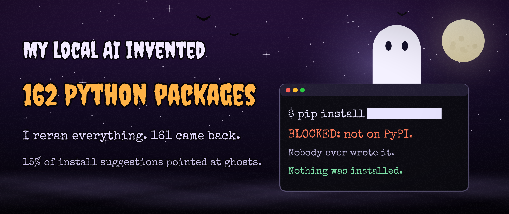

# Phantom Packages

> The model can dream a package. Only the registry can make it real.

Local open-weight coding models sometimes tell you to `pip install` packages that
don't exist. Attackers can register those names ("slopsquatting"). This repo:

1. **Measures** how often local models summon these ghost packages.
2. **Trains TabPFN** to flag a ghost name offline, from generation-time features only.
3. **Ships a guard**: `phantom check`, a Claude Code PreToolUse hook and a GitHub Action.

Built for the DEV Hacktoberfest 2026 Open-Source AI Challenge (Week 4, "Ghost in the Machine").
Headline numbers live in [`results/summary.json`](results/summary.json). For example, 212 of the 1,410
install suggestions from three local models (15.0%) named packages that don't exist on PyPI.



## Results at a glance

All numbers come from [`results/summary.json`](results/summary.json) (run 2). No ghost name appears in any figure.

| Finding | Number | Figure |
|---|---|---|
| Install suggestions that don't exist (3 local models) | 15.0% (95% CI 11.9–18.4), 212 of 1,410 | [graveyard](output/halloween_ghost_rate_by_model.png) |
| Ghost rate on obscure vs everyday tasks | 30.0% vs 1.7% | [candles](output/halloween_ghost_rate_by_niche.png) |
| Ghost names that restate the task's words | 56.5% of 161 | [cauldron](output/halloween_ghost_types.png) |
| Ghost names suggested more than once | 40 of 161 | [pumpkins](output/halloween_repeat_ghosts.png) |
| TabPFN AUROC: by prompt / new model / unseen names | 0.975 / 0.978 / 0.948 | [ouija](output/halloween_precision_recall.png) |
| TabPFN calibration error (ECE) vs gradient boosting | 0.015 vs 0.056 | [spider web](output/halloween_calibration.png) |
| "Does it exist?" self-checks: gemma4 / Ultramarine | 143 of 271 real called missing / 60 of 161 ghosts called real | [crystal balls](output/halloween_selfcheck.png) |
| Ultramarine ghost rate, low vs high reasoning | 3.2% vs 0.4% | [potions](output/halloween_reasoning_potions.png) |
| Guard replay over all 1,199 generations (online) | 212 of 212 ghosts blocked; 13 of 1,165 real stopped | [gate](output/halloween_guard.png) |
| Full rerun from scratch | 161 of 162 ghost names back; 98.7% of outputs identical | [mirror](output/halloween_reproducibility.png) |

Where TabPFN loses: gradient boosting has higher precision at 90% recall on every split (0.762 vs 0.749 by
prompt), and the hosted Ultramarine self-check, scored by P(no), has a higher AUPRC (0.880 vs 0.866) and ties
on unseen names (0.950 vs 0.948). Demo recordings: [`output/demo_hook_blocks_ghost.gif`](output/demo_hook_blocks_ghost.gif),
[`output/demo_offline_check.gif`](output/demo_offline_check.gif).

## Install

```powershell
git clone https://github.com/T-RexBytes/phantom-packages
cd phantom-packages
uv sync                  # the guard: PyPI checks, CLI, hook
uv sync --extra model    # + TabPFN, for P(ghost) and --offline
```

- The `model` extra installs `tabpfn` (and PyTorch).
- The first prediction downloads the TabPFN-3.5 weights. That needs a Prior Labs API key in
  `.env` (`TABPFN_TOKEN=...`, `TABPFN_NO_BROWSER=1`) and the licence accepted once at
  https://ux.priorlabs.ai.
- After that, TabPFN runs fully offline.

## CLI usage

```powershell
uv run phantom check requests                         # names...
uv run phantom check requirements.txt pyproject.toml  # ...or dependency files
uv run phantom check requirements.txt --json          # machine-readable
uv run phantom why requests                           # one detailed card
uv run phantom scan-cmd "pip install -U requests"     # what the hook runs
uv run phantom stats                                  # headline study numbers
```

`check` prints one row per name: Name · Verdict · P(ghost) · Band · Reasons.

| Verdict | Meaning |
|---|---|
| `OK` | Exists on PyPI and matches no squat rule (or is in the standard library). |
| `SUSPECT` | Exists, but looks like a possible slopsquat: few releases, young, rarely downloaded, or ghost-like and new. |
| `GHOST` | PyPI returns 404: nobody ever published it. |
| `GHOST_LIKELY` / `OK_UNVERIFIED` | Offline estimate only: PyPI was not asked (or could not be reached). |

Exit codes for `check` and `scan-cmd`: `0` all OK · `1` a SUSPECT · `2` a GHOST (or GHOST_LIKELY) · `3` usage error.

Every reason is a short string written by deterministic code from registry facts. No LLM writes verdicts or
reasons. The TabPFN probability is advice; the registry decides.

## Claude Code hook setup

[`hooks/claude_pretooluse_guard.py`](hooks/claude_pretooluse_guard.py) is a PreToolUse hook. Before the
Bash or PowerShell tool runs, the hook does the following:
- **Finds installs:** it pulls the `pip install` / `uv add` / `uv pip install` names out of the command.
- **Blocks GHOST and SUSPECT names** with exit code 2. Claude sees the reason as stderr, for example:
  `phantom-packages: blocked `pip install zzq-ghostlib`: zzq-ghostlib does not exist on PyPI (P(ghost)=…). Did you mean `…`? Never install unverified names.`
- **Lets everything else through.** Commands without installs return immediately and never load the model.

Add this to `<your project>/.claude/settings.json` (also in
[`templates/settings.hook.json`](templates/settings.hook.json)), with the absolute path of your clone:

```json
{
  "hooks": {
    "PreToolUse": [
      {
        "matcher": "Bash|PowerShell",
        "hooks": [
          {
            "type": "command",
            "command": "uv run --project PATH/TO/phantom-packages python PATH/TO/phantom-packages/hooks/claude_pretooluse_guard.py",
            "timeout": 120
          }
        ]
      }
    ]
  }
}
```

| Environment variable | Effect |
|---|---|
| *(default)* | Block GHOST and SUSPECT. If PyPI can't be reached or the guard fails, allow the call and print a warning (fail-open). |
| `PHANTOM_FAIL_CLOSED=1` | Also block when PyPI can't be reached, the guard fails, or the hook input is malformed. |
| `PHANTOM_OFFLINE=1` | Never ask PyPI; block names the TabPFN estimate calls ghost-likely. |
| `PHANTOM_HOOK_PROB=1` | Also print the model's P(ghost) in every block message (adds about 10–15 s on a CPU laptop). |

**Speed.** By default the hook asks PyPI first and loads the TabPFN model only when the model can
change the outcome: offline (`PHANTOM_OFFLINE=1`), when PyPI can't be reached, or for an existing
package that is young. A name PyPI returns 404 for is blocked in about 2 seconds without loading torch.

The hook contract (stdin JSON, `tool_input.command`, exit 2 = block) was checked against the
[Claude Code hooks reference](https://code.claude.com/docs/en/hooks) on 2026-10-30.

## GitHub Action usage

[`.github/workflows/phantom-guard.yml`](.github/workflows/phantom-guard.yml) runs on pull requests that
change a `requirements*.txt` or `pyproject.toml` file:
- **GHOST:** the job fails.
- **SUSPECT:** the job passes with a warning annotation.

It runs `phantom check` on the changed files only and never installs them.

To use it in another repository, copy the workflow and check this repo out next to yours:

```yaml
      - uses: actions/checkout@v7
        with:
          fetch-depth: 0
      - uses: actions/checkout@v7
        with:
          repository: T-RexBytes/phantom-packages
          path: .phantom
      - uses: astral-sh/setup-uv@v10.3.3
      - run: uv sync --locked --project .phantom
      - run: uv run --project .phantom phantom check requirements.txt
```

CI installs only the base dependencies, so the verdicts there come from PyPI facts. P(ghost) needs
the `model` extra.

## Offline mode

```powershell
uv run phantom check requirements.txt --offline
```

- **How it decides:** with `--offline` (or `PHANTOM_OFFLINE=1` for the hook), PyPI is never asked. Each
  name gets a TabPFN probability from features of the name alone: distance to the nearest of the top
  15,000 PyPI names, affixes, a character-level language model and similar. It is flagged when
  P(ghost) ≥ τ.
- **The threshold:** τ comes from out-of-fold predictions in the study (`results/model/guard_threshold.json`).
  At τ = 0.508 it caught 90.1% of ghosts, and 74.9% of the names it flagged were ghosts. **Expect about
  one false alarm in four flags.**
- **Online is still the source of truth.** The offline estimate is for planes, firewalls and private
  code, when you can't ask the registry. With the network on, the registry decides.

## Ethics

- **Nothing a model suggests is ever installed or downloaded,** in the study or in the guard. The
  only network calls are PyPI JSON and pypistats metadata `GET`s, cached and rate-limited
  (≤5 req/s).
- **The hook sends nothing anywhere else:** only the package names it finds, to PyPI's JSON API.
- **No packages are registered.**
- **Repeated ghost names are never published.** Unregistered names that models repeat stay in a
  private, gitignored folder; public outputs use a keyed hash (HMAC-SHA256 with the secret
  `PHANTOM_ANON_KEY`), so a guessed name cannot be checked against them. A CI test fails if a public file
  contains one of those names.
- **A SUSPECT verdict is not an accusation.** It means "young, rarely downloaded and suggested by a
  model": check by hand.

## Reproduce the study

```powershell
copy .env.example .env   # fill TABPFN_TOKEN and PHANTOM_ANON_KEY (any long random string); Ultramarine key optional
uv run tasks.py env      # check Ollama, models, keys
uv run tasks.py test     # pytest
uv run tasks.py <stage>  # prompts | summon | extract | features | eval | guard-model | public-dataset | eval-public | squat | replay | ghost-types | error-analysis | figures | halloween | halloween-more | site | all
uv run tasks.py all --fast   # every stage from the cache, no model calls (about 9 minutes on a laptop CPU)
```

`--fast` needs the gitignored `data/` cache from a real run (generations, PyPI lookups, self-check answers).
Without it, the committed `results/` are the record.

### Rerun the evaluation without the private data

`results/public/dataset.csv` is the study's modelling table (887 rows) with every package name replaced by a
keyed id (`HMAC-SHA256(PHANTOM_ANON_KEY, name)[:8]`). The id can't be reversed or confirmed without the secret,
but it is enough to recompute the per-fold `global_freq` and the unseen-name split.
`uv run python experiments/12b_eval_public.py` reruns split A (by prompt) and split C (unseen names) for
TabPFN-3.5 and gradient boosting from that file alone and prints them next to `results/eval.csv`; they match
exactly. Column dictionary: [`results/public/README.md`](results/public/README.md).

The self-check baseline is reported two ways: the spec's yes/no answer (`llm_selfcheck`), and P(no) from
gemma4's top-20 first-token logprobs (`llm_selfcheck_prob`).

### Hosted comparison arm (Ultramarine, not open)

`ultramarine-1-flash` ran the same 200 prompts through the same extraction and labelling. It is a comparison
arm only: never pooled into the local-model numbers.

| Part | Calls | Cost (USD) | Result |
|---|---|---|---|
| A: low reasoning, 2 samples | 400 | 0.0666 | ghost rate 3.2% (1.5–5.2), 16 of 496 |
| B: high reasoning, 1 sample | 200 | 0.0626 | ghost rate 0.4% (0.0–1.3), 1 of 241 |
| C: "does it exist?" self-check | 434 | 0.0117 | yes/no AUROC 0.638; P(no) AUROC 0.951, AUPRC 0.880 |
| **Total** | **1,034** | **0.1409** | |

On the same 200 tasks (sample 1), 8 produced a ghost only at low reasoning, 0 only at high, 1 at both.
Sources: [`results/rates_hosted.csv`](results/rates_hosted.csv), the `hosted` section of
[`results/summary.json`](results/summary.json), the `hosted_selfcheck*` arms in [`results/eval.csv`](results/eval.csv),
and the price sheet in [`results/ultramarine_pricing.json`](results/ultramarine_pricing.json). Raw replies and the
per-call spending ledger stay in the gitignored `data/`.

Rerunning it costs money, so nothing is spent unless you say so. The evaluation reads cached hosted answers;
`--hosted-spend` only pays for names that were never asked:

```powershell
uv run python experiments/02_summon.py hosted                   # dry run: worst-case cost only, no calls
uv run python experiments/02_summon.py hosted --confirm-spend   # needs the Ultramarine key in .env
uv run python experiments/05_eval.py --hosted-spend             # paid: only asks self-check names not yet answered
```

## The Ghost Registry (local site)

`web/` is a static page that reads `web/data.json`; it is not hosted. To view it:

```powershell
python -m http.server 8000 --bind 127.0.0.1 --directory web   # then open http://127.0.0.1:8000
```

Spec: [docs/03_BUILD_SPEC.md](docs/03_BUILD_SPEC.md).
