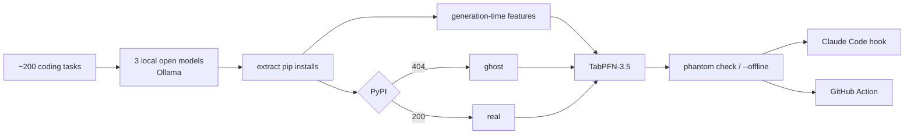

# 05: Blog Post Blueprint

**Target:** 2,200–2,900 words (the winners' median is about 2,250). Writing quality is weighted most heavily.

**Rules for this draft:**
- Every `{{…}}` must be filled from `results/summary.json`, a results CSV, or a real event.
- Never invent a number or a reaction.

---

## 0. Front matter

```yaml
---
title: {{CHOSEN TITLE}}
published: false
tags: devchallenge, hf26challenge, python, security
cover_image: {{URL to cover.png, 1000x420}}
---
```
DEV allows 4 tags; the first two are required.

## 1. Title bank (pick one after you have real numbers)

| # | Formula (from past winners) | Draft |
|---|---|---|
| A | Situation, then twist, with numbers | **My local AI summoned {{N_GHOSTS}} Python packages that don't exist. {{N_REGISTERED}} of them now do.** |
| B | "I did X. Now it does Y" | **I taught TabPFN to see ghosts: it spots a fake pip package before PyPI does, {{RECALL}}% of the time, offline** |
| C | Name: what it does for whom | **Phantom Packages: a ghost detector for the pip installs your AI agent dreams up** |
| D | Quote-hook | **"pip install {{REAL_GHOST}}" — my agent's favourite package doesn't exist** |
| E | Paradox | **The scariest package in my requirements.txt was one nobody ever wrote** |

**Recommendation:** use A if `N_REGISTERED ≥ 1`, otherwise B.

**Subtitle / description (≤150 characters):** *"Local open models invent pip packages. Attackers register them. I measured it, then built an offline TabPFN guard that blocks the install."*

---

## 2. Opening line (required)

```markdown
*This is a submission for the [Hacktoberfest Open-Source AI Challenge Week 4: Ghost in the Machine](https://dev.to/challenges/hacktoberfest-week4-2026-10-26)*
```

## 3. Hook (120–180 words): a concrete scene, no features yet

Base it on the **real hook demo** from Phase 7. Draft:

> At {{TIME}} on {{DAY}}, my coding agent typed this into my terminal:
>
> ```bash
> pip install {{REAL_GHOST}}
> ```
>
> It looked fine. The name sounded like every other helper library I've installed a hundred times. Except that package doesn't exist. Nobody wrote it. It has never had a maintainer, a release, or a README. It lived for exactly one sentence, inside a model running on my laptop.
>
> That's the ghost in the machine I went hunting for this week. The scary part isn't the ghost. It's that anyone can give it a body: register the name on PyPI, put whatever they want in `setup.py`, and wait for the next agent to dream it up again.
>
> So I asked three open-weight models to write {{N_PROMPTS}} small Python scripts, and counted the ghosts.

Then add one bold sentence with the headline result:
> **{{GHOST_RATE}}% of the packages they told me to install don't exist. {{REPEAT_RATE}}% of those ghosts came back more than once. And {{N_REGISTERED}} already have a body.**

Put a cover GIF or hero image right after the hook: the hook blocking the install.

---

## 4. `## What I Built` (250–350 words)

**Must cover:** what it is, who it's for, and how you read the theme. Use a three-part structure.

Draft:
> **Phantom Packages** is three things:
>
> 1. **The Summoning**, a study. {{N_MODELS}} open-weight models ({{MODEL_LIST}}) running locally through Ollama, {{N_PROMPTS}} realistic coding tasks across 15 domains, {{N_SAMPLES}} samples each, every `pip install` extracted and checked against PyPI.
> 2. **The Medium**, a ghost detector. A TabPFN-3.5 model that looks at a package name *and how it was born* (how close it is to a real package, whether the model repeats it, how niche the task was) and says how likely it is to be a ghost. **It doesn't need the internet.**
> 3. **The Guard**, a working tool. `phantom check` for requirements files, a **Claude Code hook** that stops an agent mid-install, and a **GitHub Action** for pull requests.
>
> It's for anyone who lets an AI agent touch their terminal. More and more of us do that without reading every command.
>
> **How I read the theme:** the ghost in this machine is a name that exists only inside the model's imagination, until someone gives it a body. Halloween is about things that shouldn't be there. Día de los Muertos is about names that refuse to be forgotten. Some of my ghosts turned out to be both: {{IF TRUE: real packages that were renamed or deleted years ago, which the model still remembers}}.

Then the rule, as its own H3:
```markdown
### The rule: the model can dream a package. Only the registry can make it real.
```
Follow it with one short paragraph:
> Models only propose. TabPFN gives a probability, not a verdict. The final call is plain code over registry facts: does it exist, how old is it, how many releases, who downloads it. And nothing a model suggests is ever installed. Not even during the study.

---

## 5. `## Demo` (100–150 words + media)

- **GIF 1 (required):** a Claude Code session where the hook blocks a real ghost and the agent recovers with the real package.
- **Link:** live Ghost Registry site `{{SITE_URL}}` (the .tech domain if claimed).
- **Optional:** a 60–90 second video walkthrough (script in 07).
- **Code block** showing CLI output:
```text
$ phantom check requirements.txt
 Name                    Verdict   P(ghost)   Band        Reasons
 requests                OK        0.02       0.01–0.03   in top-15k · 1,1xx releases
 {{GHOST_1}}             GHOST     {{p}}      {{band}}    404 on PyPI · nearest real: {{nn}} (edit 2)
 {{SUSPECT_1}}           SUSPECT   {{p}}      {{band}}    exists · 1 release · first seen {{date}} · {{dl}} downloads/mo
```
Use only **registered** or anonymised names publicly. Never show an unregistered repeated ghost.

Add the `--offline` example in one line: *"With the Wi-Fi off, the registry can't answer, but the medium still can:"*, followed by the output.

---

## 6. `## Code` (40–60 words)

```markdown

```
- MIT licence, built during the challenge window.
- "{{N_TESTS}} tests. One command per stage (`uv run tasks.py all --fast` reproduces every number in this post from the cache)."

---

## 7. `## How I Built It` (600–800 words, the technical core)

Use H3 subsections.

### 7.1 `### Summoning ghosts on purpose`
- The prompt template (quote it).
- The 15 domains, the niche levels, why niche matters.
- Models, seeds, temperature. Generation stats: {{N_GENERATIONS}} generations, {{HOURS}} hours on {{HARDWARE}}.
- One honest line about any scope cut.

### 7.2 `### Telling a ghost from a typo`
- The extraction rules (pip lines first, imports mapped second).
- The **subtypes**: `module_name_confusion` (`pip install cv2`) and `stdlib_confusion` (`pip install json`). These are real mistakes but *not* ghosts, so they're counted separately.
- One short code excerpt: the normalization plus the label function.

### 7.3 `### Teaching TabPFN to see ghosts`
- Why TabPFN: a small table (about {{N_ROWS}} rows), no time to tune, and calibrated probabilities matter.
- The features table (shortened to 8 rows).
- The **leakage rule**: no registry data in the features, so the detector only knows what the model knew.
- Splits: by prompt, leave-one-model-out, and unseen names.

### 7.4 `### The guard`
- The verdict logic as a 10-line excerpt.
- The hook contract (stdin JSON → exit code 2 blocks) and the `settings.json` snippet.
- Fail-closed on GHOST, fail-open on network errors (and why).

### 7.5 Architecture diagram (Mermaid renders on DEV)
````markdown

````

---

## 8. `## What I Measured` (450–600 words, tables)

**Table 1, ghost rate per model** (from `results/rates.csv`):

| Model | Install suggestions | Ghosts | Ghost rate (95% CI) | Generations with ≥1 ghost |
|---|---|---|---|---|
| {{m1}} | {{}} | {{}} | {{}}% ({{lo}}–{{hi}}) | {{}}% |
| {{m2}} | | | | |
| {{m3}} | | | | |
| Ultramarine (hosted) | | | | |

Add one sentence about niche level, for example: *"On obscure tasks the rate was {{x}}× higher than on everyday ones."*

**Table 2, can you spot a ghost before asking PyPI?** (from `results/eval.csv`, split A):

| Method | AUROC (95% CI) | AUPRC | Precision @ 90% recall | Brier |
|---|---|---|---|---|
| "Not in top 15k" rule | | | | |
| Edit-distance rule | | | | |
| Logistic regression | | | | |
| Gradient boosting | | | | |
| **TabPFN-3.5** | | | | |
| Gemma asking itself "does it exist?" | | | | |

**Table 3, a model it has never seen** (from `results/loo.csv`): train on 2 models, test on the third. This is the most interesting result whichever way it goes.

**Figure:** calibration plot. Caption: *"When TabPFN says 80%, it's a ghost about {{y}}% of the time."*

**Repeat ghosts:** *"{{REPEAT_RATE}}% of ghosts were summoned more than once, and {{CROSS_MODEL_RATE}}% by more than one model. Those are the dangerous ones: predictable enough to squat."*

**Already haunted:** *"{{N_REGISTERED}} names the models invented exist on PyPI today. {{N_SUSPECT}} of them match my squat rules (≤3 releases, first published in the last 24 months, <500 downloads a month). I haven't installed any of them, and I reported {{…}} to the PyPI security team."* Only say that last part if it's true.

---

## 9. `## What Went Wrong` (250–400 words, at least 3 real failures, with numbers)

This is the trait winners share most (19/20). Candidates to look for in your own build:
- The extractor's first version mislabelled `{{x}}` (for example, treated `pip install -r` or `cv2` as ghosts). It took the ghost rate from {{a}}% to {{b}}% before the fix.
- Leakage: `global_freq` computed on all the data inflated AUROC from {{}} to {{}}.
- TabPFN lost to {{arm}} on {{split}}. Say so, and say why you think it happened.
- The LLM self-check said "yes, it exists" for {{k}}/{{n}} ghosts. Asking the model if it's lying doesn't work.
- Hardware or time cut: what was dropped and what that does to the confidence intervals.

---

## 10. `## Why Does Open Innovation Matter?` (300–400 words)

Use 3–4 bold-led paragraphs, then an honest concession.

> **You can't measure a ghost you can't summon on demand.** I ran the same model with the same seed thousands of times on my own laptop. With a rented API, the model behind the endpoint can change under you, and every re-run costs money. With open weights, the ghost count is a reproducible fact, not a vibe.
>
> **The guard has to work with the lights off.** People run local models exactly when they can't or won't use the cloud: on a plane, behind a firewall, on private code. A guard that has to phone a server defeats the point. TabPFN's open weights run next to the model they're checking.
>
> **Open models are the ones agents are being built on.** Small open models power a growing share of private and offline agents. If they invent packages, the community needs open tools and open data to study them. That isn't something a vendor will publish about its own model.
>
> **Honest concession:** {{if data shows it}} the hosted model invented fewer packages than my small local ones ({{x}}% vs {{y}}%). Open doesn't mean better here. It means *inspectable*: I could measure the problem and build a fix, and you can rerun all of it.

---

## 11. `## My Agent Session` (60–100 words)

- Save the build session with DevRelay and embed it, following the challenge page's `agent_session` instructions.
- One paragraph: what the agent did (tests first, eval harness, leakage audit) versus what you decided (ethics rules, which results to publish, what to refuse).
- Optional bonus: the session where *your own hook blocked your own agent* is the most on-theme thing you can embed.

---

## 12. `## The Spirit of It` (120–200 words)

This is where the real-person moment goes. Use one of these (see 02 §7):
- A friend's reaction when the hook blocked their agent: screenshot or quote. `{{TODO: real reaction}}`
- Or your own moment: the first time a ghost name came back for the third time from a *different* model, and what that felt like.
- If true, close with the past/present link. Example: *"{{x}} of the ghosts were real once: packages renamed or deleted years ago that the models still remember. On Día de los Muertos we remember names so they aren't forgotten. Some names should be."*

---

## 13. `## Prize Categories` (150–250 words, one concrete paragraph each)

> - **Best Use of TabPFN:** TabPFN-3.5 (open weights, run locally on CPU) is the core ghost detector. It's benchmarked against 5 baselines on identical GroupKFold-by-prompt folds, with leave-one-model-out and unseen-name splits, bootstrap CIs and a calibration plot. Its out-of-fold probability sets the guard's threshold (τ={{τ}} for ≥90% recall), and the 5 fold models give each verdict an uncertainty band. It ships inside the CLI, the hook and the Action, including `--offline` mode.
> - **Best Use of Ultramarine:** `ultramarine-1-flash` is the hosted comparison arm: same {{N_PROMPTS}} prompts, same extraction and labelling. Ghost rate {{x}}%. **Total run cost: ${{cost}}** ({{in_tok}} input / {{out_tok}} output tokens at the rates from `/v1/pricing`). {{optional: it also drafted the per-ghost case files from the evidence JSON, under the same rule that every claim must cite a field}}.
> - **Best Use of Gemma:** `gemma4:e4b` is one of the three summoned models and powers the "ask the model if it's lying" baseline. That baseline lost: {{AUROC}}.
> - **Best Use of a .tech Domain:** the Ghost Registry lives at `{{domain}}.tech`.
> - {{Only if real:}} **Best Use of GitHub Copilot:** …

---

## 14. Closing (2–3 lines)

> If you let an agent run `pip install`, try the hook for a day and tell me what it caught. And if you maintain a popular package, check the names one edit away from yours on the Ghost Registry.

Credit teammates here if any (DEV usernames).

---

## Style rules (taken from the winning posts)

- Short paragraphs, 1–4 sentences. Bold the one sentence per section that matters.
- Concrete numbers over adjectives. "{{n}} of {{m}}", not "most".
- One aphorism rule as an H3. Don't overuse spooky puns: at most one per section.
- Every table gets a one-line "so what" sentence below it.
- Link every number to the file that produced it, e.g. `[eval.csv](https://github.com/…/results/eval.csv)`.
- Images get alt text. GIFs under 8 MB.
- Credit prior work in one paragraph (01 §5), and say exactly what's new.
- Don't claim categories you didn't really use.

## Judge's checklist (self-review before publishing)

| Criterion | Check | ✔ |
|---|---|---|
| Writing | Hook is a scene; headline result in bold within the first 200 words; every template heading present in order; ≤3,000 words | |
| Writing | "What went wrong" has ≥3 failures with numbers | |
| Theme | The ghost metaphor is literal and explained in What I Built; Halloween + Día de los Muertos both touched | |
| Theme | Open models are at the core (3 local models + TabPFN open weights + offline mode) | |
| Creativity | The new angle (offline TabPFN, leave-one-model-out, natural experiment) is stated and prior work is credited | |
| Technical | Live site + GIF + repo + tests + reproducible command | |
| Technical | Eval table with baselines, CIs, calibration, held-out splits | |
| Partner | Each claimed category has a concrete paragraph; Ultramarine cost reported | |
| Ethics | No unregistered repeated ghost names anywhere public; nothing installed | |
| Spirit | Real reaction or a real moment, not invented | |
